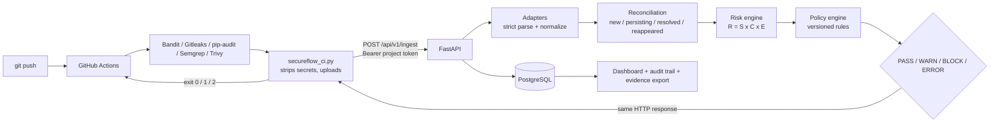

# Architecture



## Decisions made on purpose

- **Scanners run in CI, never on the backend.** The backend only receives reports.
- **Ingest returns the decision in the same response.** No second call, no race.
- **Fail-closed everywhere.** API down, bad token, missing/invalid report, unsupported scanner, required scanner
  absent, CI-side read error, no report at all → `ERROR`, exit code 2. There is no fail-open option; the policy
  schema rejects it. An ERROR run never resolves existing findings.
- **Secrets never stored.** Stripped in CI (`Secret`, `Match`, `Author`, `Email`, `Message`), replaced by an HMAC
  fingerprint; the Gitleaks adapter never reads those fields anyway (defence in depth); Bandit's hardcoded-password
  messages are redacted. Raw reports are **not** stored, only their SHA-256 and the normalized findings.
- **Idempotent ingest.** Unique on (project, CI run id, attempt): a retry returns the stored decision.
- **Stable fingerprints.** Based on rule + file + hash of the flagged line (not the line number), so edits elsewhere
  in a file don't create false "resolved + new" pairs. Semgrep OSS without login omits the code, so its fingerprint
  falls back to rule + file + occurrence index.
- **Findings are tracked per (project, branch, fingerprint).** An exception granted on another branch is inherited;
  a finding that disappears and comes back is `reappeared` and loses its exception.
- **Policies are data**, validated strictly (unknown fields rejected), versioned, and each run records the version used.

## Layout

```
app/
  main.py            app, middleware (CSP, headers, sessions), first-admin bootstrap
  models.py          11 tables           schemas.py   API payloads
  security.py        argon2, tokens, CSRF, login limiter
  api/               ingest_api.py (pipeline)   rest.py (humans/scripts)
  web/routes.py      server-rendered dashboard
  services/
    adapters/        bandit, gitleaks, pip_audit, semgrep, trivy
    ingest.py        orchestrates the whole decision
    reconciliation.py  risk_engine.py  policy_engine.py  findings.py (exceptions)
    controls.py (GRC mapping)  evidence.py  stats.py  audit.py  permissions.py
migrations/          Alembic (tested on SQLite and PostgreSQL 16)
scripts/secureflow_ci.py   the CI client (stdlib only)
demo-target/         intentionally vulnerable app + workflow to demo the chain
tests/               157 tests
```
